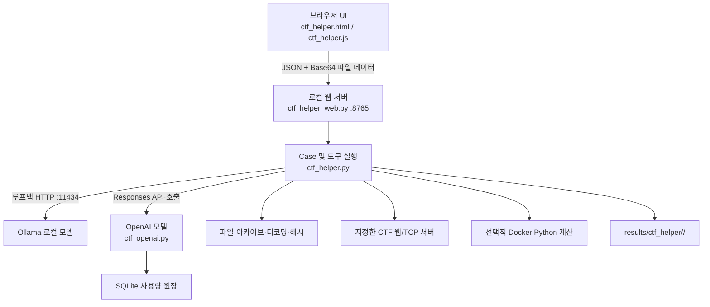

# CTF 풀이 도우미 시스템 설계 및 구현 검증 보고서

**검증 기준:** 2026-10-29 현재 저장소의 `scripts/ctf_helper.py`, `scripts/ctf_openai.py`, `scripts/ctf_helper_web.py`, `scripts/ctf_helper.js`, `scripts/ctf_helper.html`, `tests/test_ctf_helper.py`
**범위:** 현재 코드에서 확인되는 동작과 테스트 결과. 모델 성능, 외부 서비스 요금, 실제 CTF 정답률 및 보안성 전체를 입증하는 보고서는 아니다.

## 1. 목적과 적용 범위

이 도구는 CTF 문제 설명과 첨부 파일을 분석하고, 필요한 경우 사용자가 지정한 문제 서버의 응답을 확인하여 플래그 **후보와 그 출처**를 정리한다. 로컬 Ollama 모델(`qwen3:8b`, 환경 변수로 변경 가능) 또는 OpenAI Responses API 모델(`gpt-5.4-mini`, `gpt-5.4`)을 선택할 수 있다. 파일 분석, 디코딩, 해시 계산, 제한적인 HTTP 요청, 선택적 Docker Python 계산을 모델의 도구 호출로 제공한다.

이 시스템은 공식 채점 서버에 플래그를 제출하거나 정답 여부를 확인하지 않는다. 결과의 `officially_verified`는 항상 `false`이며, 서버 응답에서 발견한 문자열도 **서버에서 관찰한 후보**로 표시한다.

## 2. 구현 구조

- 웹 서버는 `127.0.0.1:8765`에 바인딩한다. API는 `GET /api/health`, `GET /api/history`, `GET /api/job/<id>`, `POST /api/solve`를 제공한다. 제출 요청은 `Host`와 `Origin` 헤더를 검사한다. 이 검사는 로컬 브라우저 사용을 전제로 한 접근 제한이며 사용자 인증 체계는 아니다.
- 브라우저는 파일을 Base64로 인코딩하여 **JSON**으로 전송한다. Multipart 업로드는 구현되어 있지 않다. 작업은 백그라운드 스레드에서 실행하며, 브라우저는 작업 상태를 조회한다. 실행은 `RUN_LOCK`으로 한 번에 하나씩 처리한다.
- OpenAI 분석 단계의 기본값은 8회, 로컬 Ollama 모드의 기본값은 25회다. 한 단계에서 도구 호출은 최대 4개를 실행한다. 필요하면 단계 종료 후 별도의 최종 요약 모델 호출이 추가될 수 있다.
- 문제 설명은 최대 16,000자, 첨부 파일은 최대 20개·각 8 MiB·합계 12 MiB다. 제출 내용과 결과는 `results/ctf_helper/<run_id>/` 아래에 저장된다.

## 3. 모델, 키 및 비용 관리

| 항목 | 로컬 Ollama | OpenAI Responses API |
|---|---|---|
| 코드상의 모델 | 기본값 `qwen3:8b` | `gpt-5.4-mini`, `gpt-5.4` |
| 연결 | `http://127.0.0.1:11434` | OpenAI SDK를 통한 외부 API |
| 준비 조건 | Ollama와 해당 모델 설치 | `openai` 패키지 및 `OPENAI_API_KEY` 환경 변수 |
| 비용 | API 사용료는 없지만 하드웨어·전력 비용은 별도 | 코드의 단가표와 사용량 원장으로 추정·관리 |
| 데이터 전송 | Ollama 요청은 루프백으로 전달 | 문제 설명, 텍스트 파일 미리보기, 도구 결과 등이 요청에 포함될 수 있음 |

로컬 모델을 선택해도 사용자가 CTF 서버 주소를 입력하면 도구가 그 서버에 네트워크 요청을 할 수 있다. 따라서 전체 시스템을 에어갭 또는 완전 오프라인이라고 부를 수 없다. OpenAI 모델을 선택하면 입력 내용이 외부 API로 전송된다. `store=False`를 지정하지만, 이 옵션 하나만으로 데이터 보관 또는 처리에 관한 모든 정책이 보장되는 것은 아니다.

### 3.1 API 키 처리

백엔드는 서버 프로세스의 `OPENAI_API_KEY` 환경 변수에서 키를 읽어 OpenAI 클라이언트 생성에 사용한다. 키는 저장소에 저장되지 않으며 브라우저에 반환하지 않는다. Python의 `del key`는 변수 참조를 제거할 뿐, 프로세스 메모리에서 키 바이트를 즉시 지운다는 보장은 아니다. 키를 환경 변수로 전달하는 방법과 보호 수준은 실행 환경에 따라 다르다.

### 3.2 예산 원장

`BudgetLedger`는 `.runtime/ctf-helper/openai-usage.sqlite3`에 요청별 예약액과 정산액을 기록한다. API 호출 전에 입력 바이트 길이와 최대 출력 토큰 수로 예약액을 추정하고, `BEGIN IMMEDIATE` 트랜잭션에서 이 도구의 실행당 **USD 2**, 누적 **USD 30** 설정 한도와 비교한다. 응답에 사용량이 있으면 입력·캐시 입력·출력 토큰에 코드의 모델별 단가를 적용해 정산한다. 사용량이 없거나 요청 결과가 불확실하면 예약액을 유지한다.

이 한도는 **이 도구의 원장에 기록된 사용량에 대한 사전 차단 장치**다. 토큰 추정이나 코드에 고정된 단가와 실제 청구 조건의 차이, 다른 프로그램의 동일 계정 사용까지 통제하지는 못한다. 따라서 실제 청구액이 절대로 한도를 넘지 않는다고 표현할 수 없다. 단가의 최신성도 별도로 확인해야 한다.

## 4. 분석 도구와 데이터 처리

### 4.1 파일과 디코딩

`Case`는 파일 이름의 경로 구분자·Windows 예약 이름·대소문자만 다른 중복 등을 검사한다. `list_files`, `read_file`, `search_files`는 업로드된 파일을 조회한다. `decode_text`는 Base64, Base32, Base85, 16진수, URL 인코딩, HTML 엔티티, 8비트 이진 토큰, ROT13, Caesar 회전, 문자열 역순, 단일 바이트 XOR을 시도한다. 이 목록은 **11개 처리 방식**을 뜻하며, 모든 인코딩을 항상 정확히 판별한다는 의미는 아니다. Caesar·역순·XOR 결과는 플래그 정규식에 맞을 때만 출력되는 경우가 있다. 16진수 입력은 비 16진수 문자를 제거하는 휴리스틱이므로 원문과 다른 해석이 생길 수 있다.

`hash_calc`는 텍스트 또는 첨부 파일에 대해 MD5, SHA-1, SHA-256 해시를 계산한다. 이 값은 파일 식별·비교를 위한 결과이며 플래그 정답 검증은 아니다.

### 4.2 바이너리와 아카이브

`analyze_binary`는 파일의 **앞부분 최대 1 MiB**를 샘플링하여 알려진 매직 바이트, 일부 ELF 정보, 샘플 섀넌 엔트로피, ASCII·UTF-16LE 인쇄 가능 문자열을 검사한다. ELF 파일은 추가로 `inspect_elf`를 통해 NX·RELRO·canary 심볼 참조·함수 심볼을 읽고, `disassemble_function`으로 선택한 함수의 기계어를 최대 200개 명령까지 디스어셈블한다. `search_binary_strings`는 파일 전체의 ASCII·UTF-16LE 문자열을 검색하고 `file_hexdump`는 지정 오프셋의 최대 512바이트를 읽는다. 모두 업로드 파일을 실행하지 않는 정적 분석이다. NX 또는 canary 참조 하나만으로 모든 함수의 보호 상태를 단정할 수는 없다.

`inspect_archive`와 `read_archive_entry`는 ZIP/TAR의 항목을 나열하거나 선택한 항목을 디스크에 풀지 않고 읽는다. 전자는 최대 200개 항목을 나열하고, 16 KiB 이하의 텍스트 항목에서 플래그 후보를 찾는다. 후자는 지정 항목의 선언된 크기가 2 MiB를 넘으면 읽지 않는다. HTTP GET으로 받은 ZIP은 최대 8 MiB까지 바이트 그대로 저장해 아카이브 항목을 검사하고, 발견한 플래그의 원격 출처를 기록한다. 따라서 모든 아카이브 내용의 완전한 검사나 임의의 악성 아카이브에 대한 안전성 증명을 의미하지 않는다. 업로드된 네이티브 바이너리를 호스트에서 직접 실행하는 코드는 이 분석 경로에 없다.

### 4.3 지정한 서버 확인

사용자가 HTTP(S) 원본을 지정하면 도구가 그 원본의 상대 경로에 GET/POST를 보낼 수 있다. 코드가 URL을 원본과 경로의 결합으로 만들고 자동 리디렉션을 막으며, 한 실행에서 도구의 HTTP 요청을 8회로 제한한다. 같은 `Case`의 `CookieJar`를 재사용하므로 세션 쿠키를 이어 사용할 수 있다. HTTP 오류 응답에서도 상태·헤더·본문을 읽는다. 다만 이것은 URL 경로 자체의 완전한 정규화나 모든 네트워크 공격에 대한 방어를 뜻하지 않는다.

TCP 주소만 지정하면 연결 직후 최대 8 KiB의 배너를 읽는다. 배너가 없을 때는 `GET / HTTP/1.1`을 한 번 보내 HTTP 응답인지 확인하고, 응답 형식이 맞으면 웹 원본으로 취급한다. 즉 TCP 확인 역시 항상 수동적인 배너 읽기만 수행하는 것은 아니다. 명시된 TCP CTF 주소에는 `tcp_exchange`가 새 연결을 열어 최대 12단계·총 4 KiB의 제한된 입력을 보낼 수 있다. 호출은 실행당 최대 8회이며 다른 호스트나 포트에는 연결할 수 없다.

### 4.4 선택적 Docker 계산

`run_python`은 사용자가 화면 옵션 또는 `--docker-python`을 켠 경우에만 실행된다. `python:3.11-alpine` 이미지가 로컬에 있어야 하며 `--pull=never`로 실행한다. 코드에는 `--network=none`, `--read-only`, `--cap-drop=ALL`, `--security-opt=no-new-privileges`, 비루트 사용자, 메모리·CPU·프로세스 제한, `/tmp`의 `noexec` 설정, 20초 제한이 있다. 첨부 파일 디렉터리는 컨테이너의 `/challenge`에 읽기 전용으로 마운트한다. 이는 위험을 줄이는 설정이며 Docker/호스트 취약점까지 포함해 완전한 격리를 보증하지 않는다.

## 5. 플래그 후보의 출처와 판정

플래그 후보는 기본 정규식 `(?:ACDC|FLAG|CTF|DH|APS)\{[^}\r\n]{1,160}\}` 또는 사용자가 입력한 정규식으로 찾는다. `DH{...}`와 같은 문제의 형식 예시를 정규식 칸에 입력하면 해당 접두사의 실제 플래그를 찾는 패턴으로 변환한다. `...`, `xxx`, `your_flag` 등 일부 예시 문자열은 제외한다. 후보별로 문제 설명·첨부 파일, 디코딩, 바이너리 문자열, 아카이브 내부, Docker 출력, 웹/TCP 응답, 모델 답변 등의 **출처와 상태**를 기록한다. 이들은 네 단계가 아니라 여러 출처 범주다.

서버 응답에서 발견한 후보는 `remote_observed`, 그 외 후보만 있으면 `candidate_only`, 후보가 없으면 `unresolved` 상태로 정리한다. `remote_observed`도 공식 정답 확인을 뜻하지 않는다. 문제 설명에 플래그 형식이 하나 명시되어 있고 첨부 파일에서 다른 형식만 발견된 경우에는 분석 전 오류를 표시한다. 사용자가 `형식 불일치 허용` 옵션을 켜면 계속 진행할 수 있다. 이 검사는 형식이 명확하게 감지되는 경우에 한정된다.

## 6. 사용자 화면 및 검증 결과

화면은 HTML/CSS/Vanilla JavaScript로 구성되어 별도의 프런트엔드 프레임워크나 CDN을 사용하지 않는다. 모델 준비 상태와 이 도구의 예산 원장 잔액, 최근 실행 목록, 파일 드래그 앤 드롭, 접속 문자열 추출, 플래그·보고서 복사, `Ctrl+Enter` 실행을 제공한다. 최근 실행 목록은 결과 폴더 중 최신 25개를 확인하므로, 그중 결과 파일이 없는 폴더가 있으면 표시되는 이력은 25개보다 적을 수 있다. 클립보드 복사는 브라우저 권한과 지원 여부에 따른다.

저장소 루트에서 `python tests/test_ctf_helper.py`를 실행해 자동 테스트를 확인할 수 있다. 테스트는 입력 검증과 6 MiB 파일 허용, 미끼 플래그 제외, TCP 교환, 디코더, 아카이브·바이너리 검사, HTTP 도구와 원격 ZIP 처리, Docker 명령 구성, OpenAI incomplete 재시도·원장 처리를 모의 객체와 임시 디렉터리로 확인한다. 이 결과는 실제 CTF 서버에서의 정답률, 실제 OpenAI 청구액, Docker 격리의 공격 저항성을 검증한 결과는 아니다.

## 7. 현재 한계와 후속 작업

1. 공식 플래그 제출·채점 기능이 없어 모든 결과는 후보로 다뤄야 한다.
2. 바이너리 분석은 일부 헤더와 문자열 중심이다. Ghidra 같은 디컴파일러 연동과 보호 기법 검사는 향후 작업이다.
3. 예산 원장의 가격표는 코드에 고정되어 있다. 실제 과금 조건과 정기적으로 대조하고, 계정 측 예산 제한과 함께 사용해야 한다.
4. HTTP 요청 제한과 Docker 옵션은 위험 완화 수단이다. 경로·헤더 검증, 아카이브 처리, 실제 격리 동작을 별도로 검증할 필요가 있다.
5. 기호 실행, 웹 사이트맵 자동 수집은 현재 구현 범위에 포함되지 않는다.
